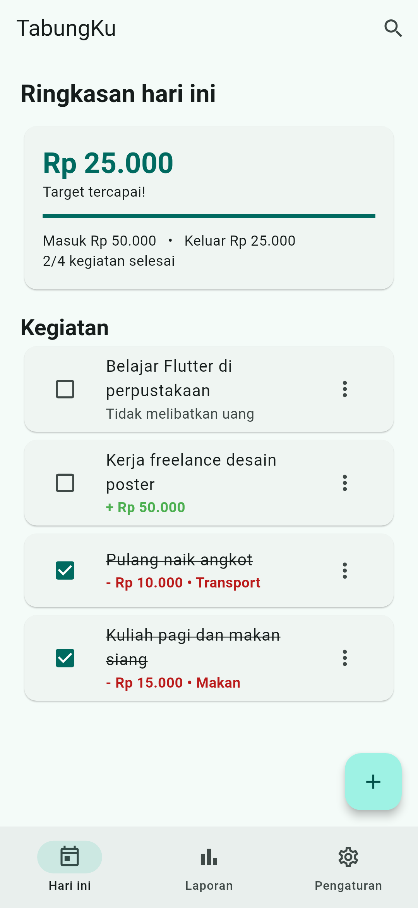
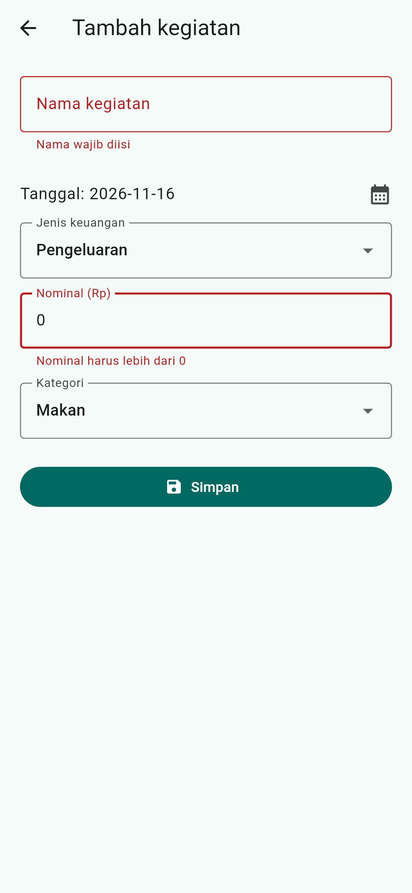
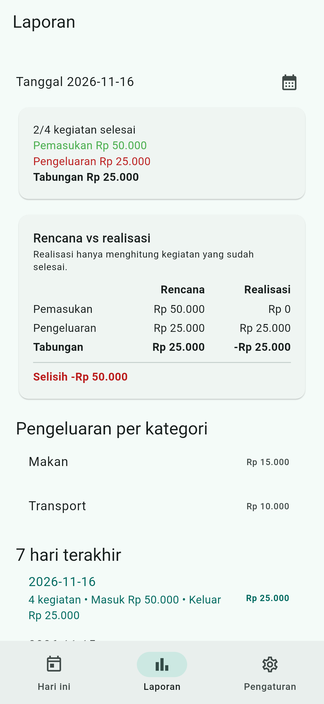
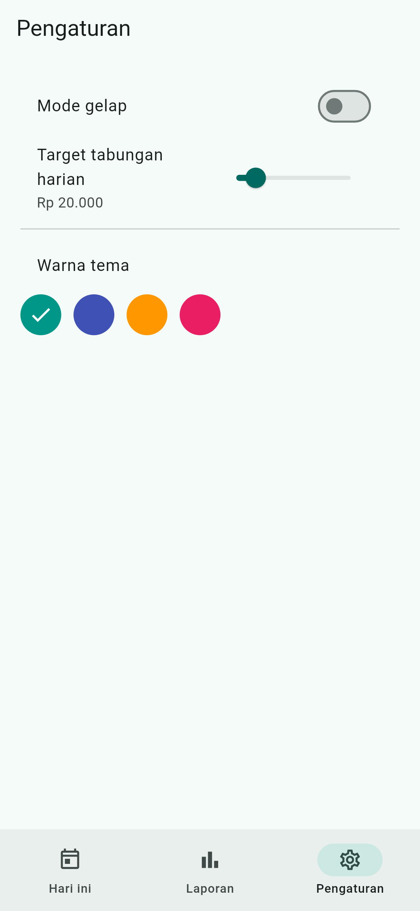
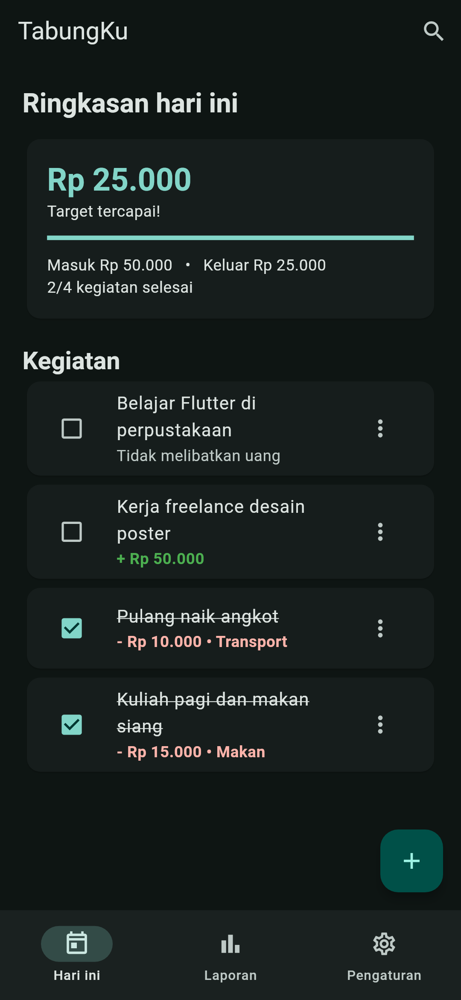
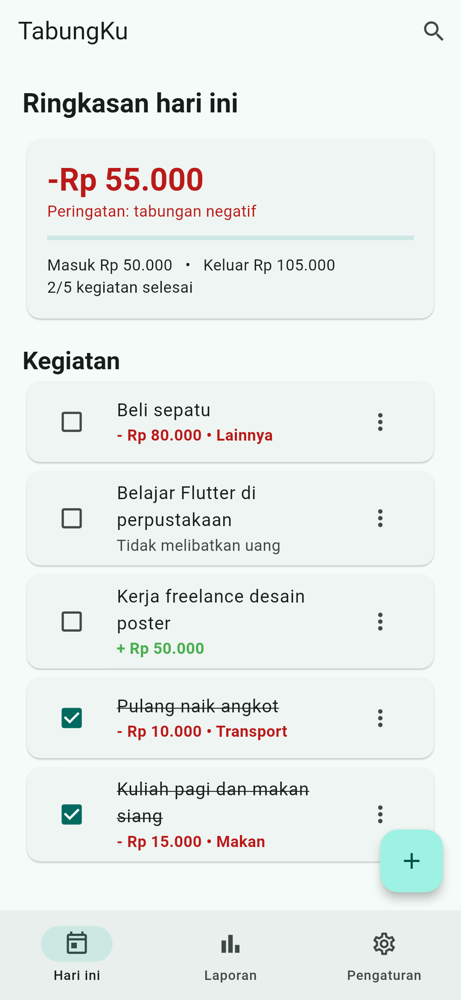

# TabungKu

TabungKu adalah aplikasi Flutter untuk mencatat kegiatan harian sekaligus pemasukan dan pengeluarannya, lalu meringkasnya menjadi laporan harian untuk melatih kebiasaan menabung. Proyek ini adalah mini proyek Pertemuan 7.

## Fitur Wajib

| Kode | Fitur | Lokasi |
| --- | --- | --- |
| F1 | Daftar kegiatan hari ini: centang selesai, ubah, dan hapus dengan konfirmasi | `pages/beranda_page.dart`, `widgets/kegiatan_tile.dart` |
| F2 | Form tambah/ubah: nama, tanggal (date picker), jenis keuangan, nominal, kategori, semua tervalidasi | `pages/form_kegiatan_page.dart` |
| F3 | Penyimpanan SQLite (tabel `kegiatan`) | `data/db_helper.dart` |
| F4 | Ringkasan hari ini: jumlah kegiatan, pemasukan, pengeluaran, tabungan | `widgets/ringkasan_card.dart` |
| F5 | Laporan: pilih tanggal, ringkasan, pengeluaran per kategori, dan 7 hari terakhir | `pages/laporan_page.dart` |
| F6 | Target tabungan harian dan progress beranimasi (`TweenAnimationBuilder`) | `widgets/ringkasan_card.dart` |
| F7 | Pengaturan mode gelap, warna tema, dan target, tersimpan dengan `shared_preferences` | `state/pengaturan.dart`, `pages/pengaturan_page.dart` |
| F8 | `NavigationBar` tiga tab; form dan pencarian dibuka lewat named route | `pages/shell_page.dart`, `main.dart` |

Nominal pemasukan tampil hijau dengan tanda `+`, sedangkan pengeluaran tampil merah dengan tanda `-`. Tabungan negatif tampil merah disertai peringatan, dan tabungan yang mencapai target mendapat apresiasi.

## Fitur Pengembangan Lanjutan

Dua fitur dari bagian 8 modul yang dipilih:

1. **Rencana vs realisasi.** Kartu "Rencana vs realisasi" di halaman Laporan membandingkan dua angka. *Rencana* menghitung semua kegiatan pada tanggal itu, sesuai aturan bisnis utama. *Realisasi* hanya menghitung kegiatan yang sudah dicentang selesai. Kartu ini menampilkan pemasukan, pengeluaran, dan tabungan untuk keduanya, beserta **selisih** (realisasi − rencana). Kedua angka dihitung dalam satu query memakai `CASE WHEN tipe = ... AND selesai = 1`.
2. **Pencarian dan filter.** Ikon cari di AppBar tab Hari ini membuka halaman **Cari kegiatan** (named route `/cari`). Halaman ini mencari di semua tanggal berdasarkan nama (`judul LIKE ?` dengan `'%kata%'`), jenis keuangan (`tipe = ?`), dan kategori (`kategori = ?`, khusus pengeluaran). Semua query memakai placeholder `?` dan `whereArgs`. Hasilnya dapat dicentang, diubah, dan dihapus seperti di tab Hari ini.

## Menjalankan

```bash
flutter pub get
flutter run
```

## Struktur Folder

```text
lib/
  main.dart                      tema + named routes (/form-kegiatan, /cari)
  models/kegiatan.dart           Kegiatan, TipeKeuangan, Ringkasan, daftar kategori
  data/db_helper.dart            SQLite: CRUD, ringkasan, per kategori, 7 hari, cari
  state/pengaturan.dart          tema, warna, target (shared_preferences)
  utils/format.dart              format rupiah, tanggal, dan daftar 7 hari
  widgets/ringkasan_card.dart    kartu ringkasan + progress target
  widgets/kegiatan_tile.dart     satu baris kegiatan + dialog konfirmasi hapus
  pages/shell_page.dart          NavigationBar 3 tab
  pages/beranda_page.dart        kegiatan hari ini
  pages/form_kegiatan_page.dart  tambah/ubah kegiatan
  pages/laporan_page.dart        laporan + rencana vs realisasi + 7 hari terakhir
  pages/cari_page.dart           pencarian dan filter kegiatan
  pages/pengaturan_page.dart     pengaturan
test/
  logika_test.dart               format, Ringkasan (rencana/realisasi), model
  widget_kegiatan_test.dart      warna nominal, coret selesai, peringatan, dialog hapus
  widget_test.dart               navigasi utama
```

## Aturan Perhitungan

- **Tabungan harian = total pemasukan − total pengeluaran** dari semua kegiatan pada tanggal itu, baik yang sudah selesai maupun belum (aturan modul).
- **Realisasi** (fitur lanjutan) hanya menghitung kegiatan yang sudah selesai. **Selisih = tabungan realisasi − tabungan rencana**. Nilai negatif berarti masih ada pemasukan yang belum diterima. Nilai positif berarti ada pengeluaran yang belum terjadi.
- Daftar **7 hari terakhir** berisi tanggal terpilih dan 6 hari sebelumnya. Tanggal tanpa kegiatan tetap ditampilkan dengan nilai Rp 0. Mengetuk satu baris membuka laporan tanggal tersebut.
- Semua halaman mendengarkan `versiData` (`addListener` di `initState`, `removeListener` di `dispose`), sehingga perubahan di satu tab langsung terlihat di tab lain.

## Pengujian Otomatis

```bash
flutter analyze   # target: No issues found!
flutter test
```

`sqflite` tidak berjalan di `flutter test` tanpa paket tambahan. Karena itu, pengujian otomatis hanya mencakup fungsi murni dan widget, sedangkan query database diuji lewat skenario di bawah.

## Skenario Uji

Isi kolom **Hasil** dengan *Lulus* atau *Tidak*, dan tulis catatan bila gagal.

| No | Langkah | Hasil yang diharapkan | Hasil | Catatan |
| --- | --- | --- | --- | --- |
| 1 | Tambah kegiatan "Belajar" jenis Tidak | Muncul di daftar; jumlah kegiatan naik; pemasukan/pengeluaran tidak berubah | | |
| 2 | Tambah kegiatan jenis Pemasukan Rp 50.000 | Pemasukan Rp 50.000; tabungan naik Rp 50.000; nominal hijau dengan tanda + | | |
| 3 | Tambah kegiatan jenis Pengeluaran Rp 15.000 kategori Makan | Pengeluaran naik; tabungan turun; kategori Makan muncul di Laporan | | |
| 4 | Simpan kegiatan bernama kosong / nominal kosong / nominal 0 | Pesan kesalahan tampil dan data tidak tersimpan | | |
| 5 | Centang selesai dua kegiatan | Kartu ringkasan menunjukkan selesai/total yang benar; judul tercoret | | |
| 6 | Ubah nominal kegiatan yang sudah ada | Ringkasan dan laporan ikut berubah tanpa restart | | |
| 7 | Hapus kegiatan (pilih Batal, lalu Hapus) | Batal tidak menghapus; Hapus menghapus dan ringkasan berkurang | | |
| 8 | Tambah kegiatan bertanggal kemarin | Tidak muncul di Hari Ini; muncul di Laporan pada tanggal itu dan pada daftar 7 hari | | |
| 9 | Ubah target dan warna, aktifkan mode gelap, tutup aplikasi lalu buka lagi | Semua pengaturan dan data tetap | | |
| 10 | Buat pengeluaran lebih besar dari pemasukan | Tabungan negatif berwarna merah dan muncul pesan peringatan | | |

## Tangkapan Layar

Daftar berkas yang wajib ada tercantum di [`docs/screenshots/README.md`](docs/screenshots/README.md).

| Hari Ini | Form (pesan kesalahan) | Laporan |
| --- | --- | --- |
|  |  |  |

| Pengaturan | Mode gelap | Tabungan negatif |
| --- | --- | --- |
|  |  |  |
