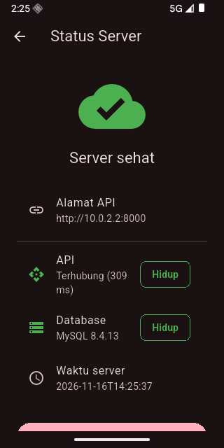
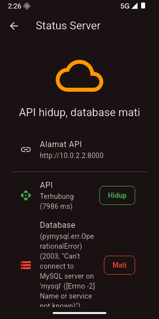
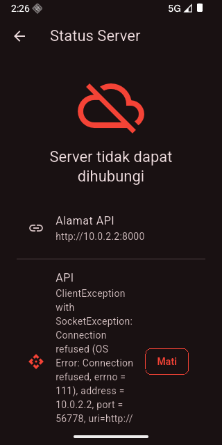
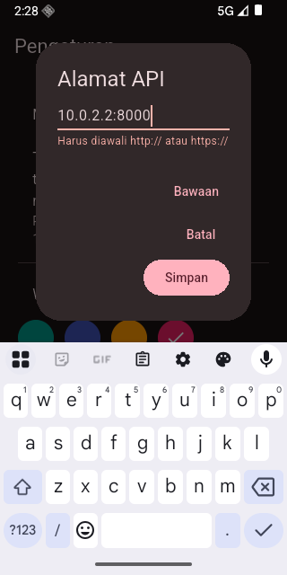

# Tugas Praktikum Flutter Pertemuan 8

## Identitas

- **Nama:** Luqman Syahreno
- **NIM:** 20240801016
- **Program Studi:** Teknik Informatika
- **Mata Kuliah:** Pemrograman Mobile
- **Pertemuan:** 8 - Docker Compose dan Kerangka Backend TabungKu Cloud

## Deskripsi Tugas

Mengembangkan hasil praktikum TabungKu Cloud agar status **API** dan **database** dapat dipantau secara terpisah, isi database dapat dilihat dari browser lewat Adminer, dan alamat API dapat diubah dari aplikasi.

## Ketentuan Tugas

- [x] Layanan **Adminer** (`adminer:5`) di port 8081, server `mysql`.
- [x] `GET /health` memeriksa database dengan `SELECT VERSION()` dan membalas `{"status","waktu_server","database","mysql_version"}`.
- [x] Bila database tidak dapat dihubungi, API membalas **503** dengan `"database": "error"` dan pesan `detail`.
- [x] Halaman Status Server menampilkan status **API** dan **Database** secara terpisah; kode 503 dibaca sebagai "API hidup, database mati".
- [x] Alamat API dapat diubah dari halaman Pengaturan (dialog dengan validasi URL) dan tersimpan dengan `shared_preferences`.
- [x] Unit test `MockClient` untuk kasus sehat, 503, dan kode lain.

## Berkas yang Diubah

| Berkas | Perubahan |
| --- | --- |
| [`docker-compose.yml`](../docker-compose.yml) | Layanan `adminer` di port 8081 |
| [`backend/app/main.py`](../backend/app/main.py) | `/health` menjalankan `SELECT VERSION()`; 200 bila sehat, 503 bila database mati |
| [`backend/app/database.py`](../backend/app/database.py) | `connect_timeout` 3 detik agar 503 dibalas sebelum aplikasi timeout |
| [`lib/config/api_config.dart`](../lib/config/api_config.dart) | Alamat bawaan, `validasiApiUrl()`, `rapikanApiUrl()` |
| [`lib/services/health_service.dart`](../lib/services/health_service.dart) | `cekServer(baseUrl)`: 200 dan 503 menjadi `StatusServer`, kode lain melempar galat |
| [`lib/state/pengaturan.dart`](../lib/state/pengaturan.dart) | `apiUrl` disimpan di `shared_preferences` (kunci `api_url`) |
| [`lib/pages/pengaturan_page.dart`](../lib/pages/pengaturan_page.dart) | Dialog **Alamat API** dengan validasi, tombol Simpan/Batal/Bawaan |
| [`lib/pages/status_server_page.dart`](../lib/pages/status_server_page.dart) | Baris status API dan Database terpisah (hijau/oranye/merah) |
| [`test/health_service_test.dart`](../test/health_service_test.dart) | Tes 200, 503, 500, dan validasi URL |

Perbaikan tambahan pada kode praktikum:

- Tombol **Periksa lagi** sebelumnya tidak berfungsi karena `setState(() => _future = ...)` mengembalikan `Future`, yang ditolak Flutter. Sekarang memakai blok `{ }`.
- Isi halaman Status Server dibungkus `SafeArea` agar tombol tidak tertutup gesture bar Android.

## Respons `/health`

Sehat (200):

```json
{"status": "ok", "waktu_server": "2026-11-16T14:07:18", "database": "ok", "mysql_version": "8.4.13"}
```

Database mati (503):

```json
{"status": "error", "waktu_server": "2026-11-16T14:07:28", "database": "error", "mysql_version": null,
 "detail": "(pymysql.err.OperationalError) (2003, \"Can't connect to MySQL server on 'mysql' ...\")"}
```

## Cara Menguji

Jalankan semua perintah dari folder `pertemuan8/`.

### 1. Menyalakan layanan

```bash
cp .env.example .env          # sekali saja
docker compose up -d --build
docker compose ps             # mysql "healthy", api dan adminer "Up"
```

### 2. Backend

| Uji | Perintah / langkah | Hasil yang diharapkan |
| --- | --- | --- |
| Sehat | `curl -i localhost:8000/health` | `200`, `"database":"ok"`, `mysql_version` terisi |
| Database mati | `docker compose stop mysql` lalu `curl -i localhost:8000/health` | `503`, `"database":"error"`, ada `detail` |
| Pulihkan | `docker compose start mysql`, tunggu ±10 detik, ulangi `curl` | Kembali `200` |
| Swagger | Buka http://localhost:8000/docs | `/health` terdokumentasi dengan respons 200 dan 503 |
| Adminer | Buka http://localhost:8081, isi Server `mysql`, User `tabungku`, Password `rahasia_tabungku`, Database `tabungku` | Masuk dan melihat database `tabungku` |

### 3. Unit test Flutter

```bash
flutter test test/health_service_test.dart   # tes tugas saja
flutter test                                 # seluruh tes
```

Harus lulus: 200 (sehat), 503 (database mati, tidak melempar galat), 500 (melempar galat), serta validasi URL.

### 4. Aplikasi di emulator

```bash
flutter run
```

1. **Pengaturan → Status server**: ikon hijau "Server sehat", API dan Database **Hidup**, versi MySQL tampil.
2. `docker compose stop mysql` → **Periksa lagi**: ikon oranye "API hidup, database mati", API **Hidup**, Database **Mati** dengan pesan galat.
3. `docker compose stop api` → **Periksa lagi**: ikon merah "Server tidak dapat dihubungi", API **Mati**, Database **?**.
4. `docker compose start mysql api` → **Periksa lagi**: kembali hijau.
5. **Pengaturan → Alamat API**:
   - Isi `10.0.2.2:8000` lalu **Simpan**: muncul pesan "Harus diawali http:// atau https://".
   - Isi alamat salah yang sah formatnya, misalnya `http://10.0.2.2:9000`, lalu **Simpan**: Status Server menjadi merah.
   - Tutup paksa lalu buka lagi aplikasi: alamat `:9000` masih tersimpan.
   - Tekan **Bawaan** untuk kembali ke `http://10.0.2.2:8000`.

> Saat MySQL dimatikan, `/health` butuh ±8 detik untuk membalas 503 karena DNS Docker mencari nama `mysql` yang sudah hilang. Tunggu sampai indikator loading selesai.

## Tangkapan Layar

| Sehat | Database mati | API mati | Validasi alamat |
| --- | --- | --- | --- |
|  |  |  |  |

Masih perlu ditambahkan secara manual untuk pengumpulan: `docker compose ps`, Swagger `/docs`, dan halaman Adminer.
