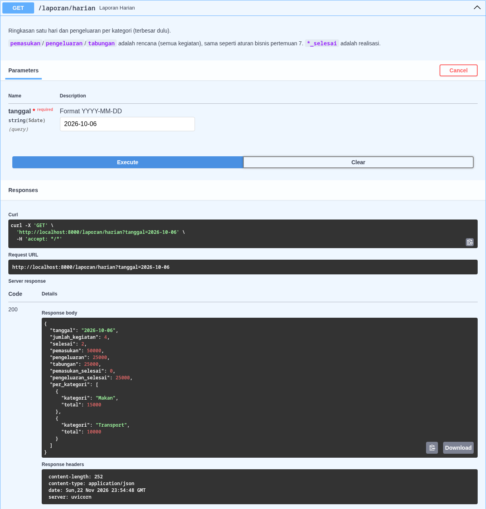
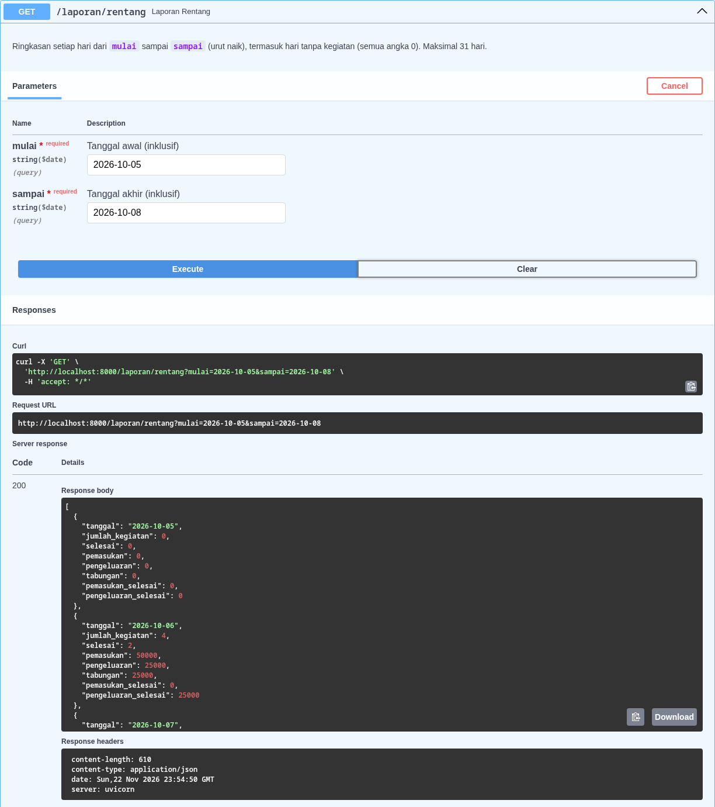
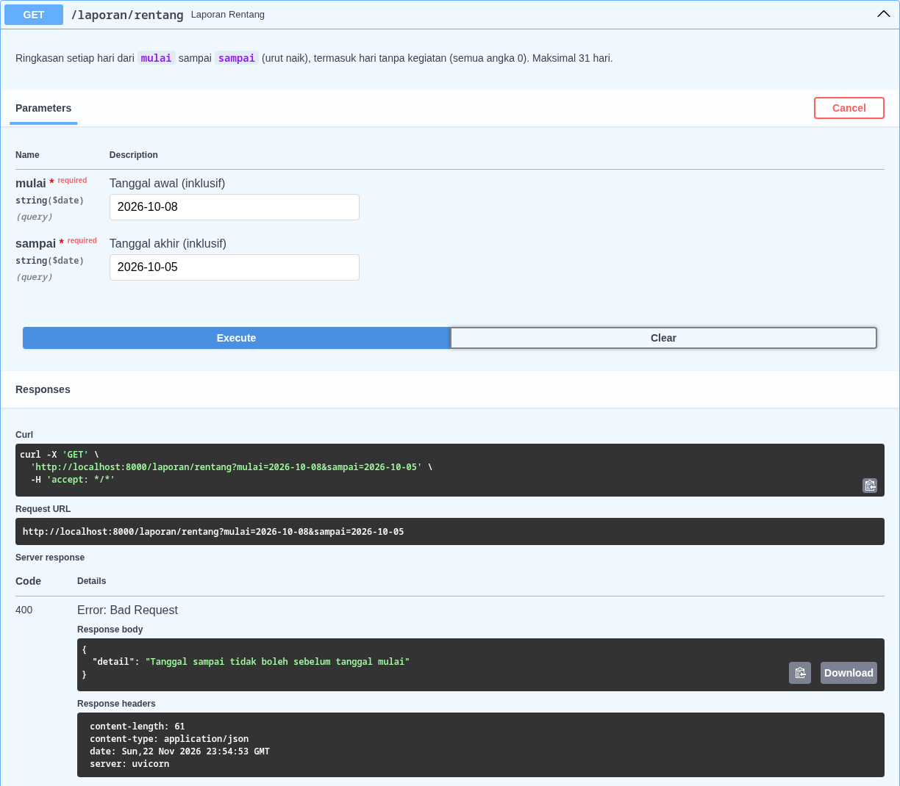
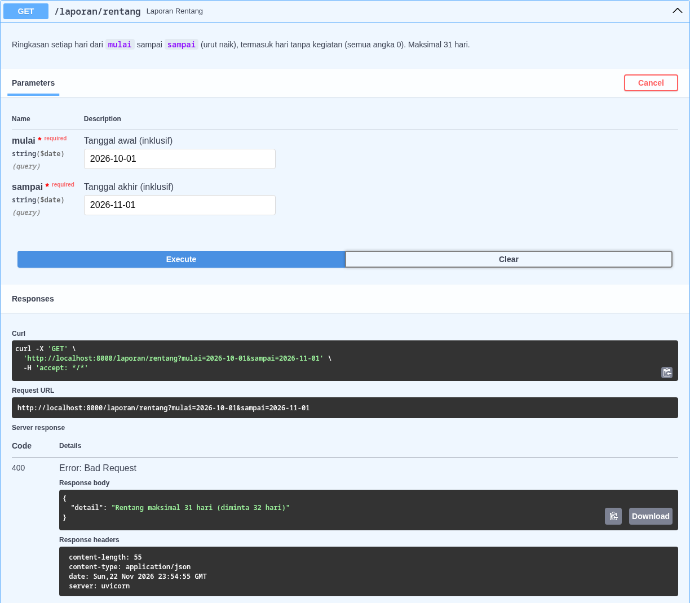

# Latihan Mandiri dan Tugas Praktikum Flutter Pertemuan 9

## Identitas

- **Nama:** Luqman Syahreno
- **NIM:** 20240801016
- **Program Studi:** Teknik Informatika
- **Mata Kuliah:** Pemrograman Mobile
- **Pertemuan:** 9 - REST API CRUD dengan FastAPI, SQLAlchemy, dan Alembic

Hasil praktikum Bagian A–G dan tabel uji Bagian F ada di [README.md](../README.md#hasil-uji-bagian-f-swagger-ui).

---

## Latihan Mandiri

### 1. Filter `selesai` pada `GET /kegiatan`

Parameter `selesai: bool | None` di [`routers/kegiatan.py`](../backend/app/routers/kegiatan.py). Pengecekannya memakai `if selesai is not None`, bukan `if selesai:`, karena `selesai=false` juga harus memfilter. Nilai yang bukan boolean dibalas 422 oleh FastAPI.

| Permintaan | Hasil (id) | `x-total-count` |
| --- | --- | --- |
| `GET /kegiatan` | 8, 7, 6, 5, 4 | 5 |
| `GET /kegiatan?selesai=true` | 5, 4 | 2 |
| `GET /kegiatan?selesai=false` | 8, 7, 6 | 3 |
| `GET /kegiatan?selesai=mungkin` | 422 `bool_parsing` | – |

### 2. Parameter `urut` (`terbaru` / `terlama`)

`urut` bertipe enum `Urutan` di [`schemas.py`](../backend/app/schemas.py), sehingga Swagger menampilkannya sebagai dropdown dan nilai lain ditolak 422. Bawaannya `terbaru`.

| Nilai | `ORDER BY` |
| --- | --- |
| `terbaru` | `selesai, tanggal DESC, id DESC` |
| `terlama` | `selesai, tanggal ASC, id ASC` |

Kegiatan yang belum selesai tetap di atas (perilaku pertemuan 7). `urut` hanya mengganti arah urutan di dalam kelompok itu.

| Permintaan | Hasil (id, tanggal, selesai) |
| --- | --- |
| `?urut=terbaru` | (8, 10-08, belum), (7, 10-06, belum), (6, 10-06, belum), (5, 10-06, ✓), (4, 10-06, ✓) |
| `?urut=terlama` | (6, 10-06, belum), (7, 10-06, belum), (8, 10-08, belum), (4, 10-06, ✓), (5, 10-06, ✓) |
| `?urut=acak` | 422: `Input should be 'terbaru' or 'terlama'` |

### 3. Revisi Alembic `0001b` (kolom `catatan`)

Langkah yang dijalankan:

```bash
# 1. Tambah sementara di models.py:  catatan: Mapped[str | None] = mapped_column(Text)
docker compose exec api alembic revision --autogenerate -m "tambah kolom catatan" --rev-id 0001b
#    INFO  [alembic.autogenerate.compare.tables] Detected added column 'kegiatan.catatan'
#    Generating /code/alembic/versions/0001b_tambah_kolom_catatan.py ...  done
```

Isi revisi hasil autogenerate (sudah diperiksa: hanya menambah/menghapus satu kolom, tidak ada operasi lain yang tak terduga):

```python
revision: str = '0001b'
down_revision: str | Sequence[str] | None = '0001'

def upgrade() -> None:
    op.add_column('kegiatan', sa.Column('catatan', sa.Text(), nullable=True))

def downgrade() -> None:
    op.drop_column('kegiatan', 'catatan')
```

Berkas muncul langsung di laptop (`backend/alembic/versions/`) karena seluruh folder `backend` di-mount ke container.

```bash
docker compose exec api alembic upgrade head   # Running upgrade 0001 -> 0001b, tambah kolom catatan
docker compose exec api alembic downgrade -1   # Running downgrade 0001b -> 0001, tambah kolom catatan
```

Pengamatan di Adminer (struktur tabel `kegiatan` dan isi `alembic_version`):

| Kondisi | Kolom terakhir tabel `kegiatan` | `alembic_version` |
| --- | --- | --- |
| Sebelum | `... kategori, created_at, updated_at` | `0001` |
| Setelah `upgrade head` | `... updated_at, catatan` (`text`, nullable `YES`) | `0001b` |
| Setelah `downgrade -1` | `... kategori, created_at, updated_at` (kolom `catatan` hilang beserta isinya) | `0001` |

- Data lama tetap utuh setelah upgrade karena kolom baru boleh `NULL`.
- `downgrade` menghapus kolom beserta isinya. Bila sempat diisi, catatannya ikut hilang.

Setelah itu revisi `0001b` dihapus dan `catatan` dibuang dari model, sesuai instruksi agar pertemuan 10 dimulai dari `0001`. Urutannya penting: **downgrade dulu, baru hapus berkas**. Kalau berkas dihapus selagi database masih di `0001b`, muncul galat `Can't locate revision identified by '0001b'`. Kondisi akhir:

```bash
docker compose exec api alembic current   # 0001 (head)
docker compose exec api alembic check     # No new upgrade operations detected.
```

### 4. Mengirim `"tanggal": "06-10-2026"`

Permintaan `POST /kegiatan` dengan `{"judul": "x", "tanggal": "06-10-2026"}` dibalas **422**:

```json
{"detail": [{
  "type": "date_from_datetime_parsing",
  "loc": ["body", "tanggal"],
  "msg": "Input should be a valid date or datetime, invalid character in year",
  "input": "06-10-2026",
  "ctx": {"error": "invalid character in year"}
}]}
```

Penjelasan:

- Field `tanggal` bertipe `date`, jadi Pydantic hanya menerima format ISO 8601 `YYYY-MM-DD` (atau datetime ISO).
- Parser membaca empat karakter pertama sebagai tahun. Di `"06-10-2026"`, karakter ketiga adalah `-`, sehingga muncul pesan *invalid character in year*.
- `loc: ["body", "tanggal"]` menunjukkan letak galatnya: badan permintaan, field `tanggal`.
- `input` berisi nilai yang dikirim.
- Galat terjadi saat validasi, sebelum fungsi endpoint dijalankan, sehingga tidak ada data yang tersimpan.
- Di Flutter, `ApiException` menampilkan isi `msg`.

Hal yang sama berlaku untuk query: `GET /laporan/harian?tanggal=06-10-2026` dibalas 422 dengan `loc: ["query", "tanggal"]`.

---

## Tugas: Endpoint Laporan

### Ketentuan

- [x] `GET /laporan/harian?tanggal=YYYY-MM-DD` membalas `jumlah_kegiatan`, `selesai`, `pemasukan`, `pengeluaran`, `tabungan`, `tanggal`, dan `per_kategori` (daftar `{kategori, total}`, terbesar dulu).
- [x] Dihitung di SQL (`COUNT`, `SUM(CASE WHEN ...)`, `COALESCE`, `GROUP BY`), bukan perulangan Python atas data.
- [x] `GET /laporan/rentang?mulai=...&sampai=...` membalas ringkasan setiap hari, termasuk hari tanpa kegiatan (bernilai 0), dengan satu query `GROUP BY tanggal`.
- [x] Rentang terbalik atau lebih dari 31 hari ditolak dengan **400**.
- [x] Hasil "Contoh Skenario Satu Hari" modul 7 persis: 4 kegiatan, 2 selesai, pemasukan 50.000, pengeluaran 25.000 (Makan 15.000, Transport 10.000), tabungan 25.000.
- [x] Flutter: `Ringkasan.fromJson`, kelas `LaporanHarian`, `LaporanApi.harian(tanggal)` dan `rentang(mulai, sampai)`, beserta unit test `MockClient`.

### Berkas yang Diubah

| Berkas | Perubahan |
| --- | --- |
| [`backend/app/routers/laporan.py`](../backend/app/routers/laporan.py) | `GET /laporan/harian`, `GET /laporan/rentang`; kolom agregat bersama `_kolom_ringkasan()` |
| [`backend/app/schemas.py`](../backend/app/schemas.py) | `KategoriTotal`, `RingkasanHari`, `LaporanHarian` (+ `Urutan` untuk latihan 2) |
| [`backend/app/main.py`](../backend/app/main.py) | Mendaftarkan `laporan.router` |
| [`backend/app/routers/kegiatan.py`](../backend/app/routers/kegiatan.py) | Latihan 1–2: filter `selesai`, parameter `urut` |
| [`lib/models/kegiatan.dart`](../lib/models/kegiatan.dart) | `Ringkasan.fromJson()` |
| [`lib/models/laporan.dart`](../lib/models/laporan.dart) | Kelas `LaporanHarian` (`tanggal`, `ringkasan`, `perKategori`) |
| [`lib/services/laporan_api.dart`](../lib/services/laporan_api.dart) | `LaporanApi.harian()` → `LaporanHarian`; `rentang()` → `Map<String, Ringkasan>` |
| [`lib/services/api_util.dart`](../lib/services/api_util.dart) | `apiUri()` dan `cekRespons()` dipakai bersama oleh `KegiatanApi` dan `LaporanApi` |
| [`test/laporan_api_test.dart`](../test/laporan_api_test.dart) | 9 tes `MockClient` |

### Keputusan Desain

**Rencana vs realisasi.** `pemasukan`, `pengeluaran`, dan `tabungan` dihitung dari semua kegiatan pada tanggal itu, sama seperti aturan bisnis pertemuan 7. Inilah yang menghasilkan tabungan 25.000 pada skenario, walaupun pemasukan 50.000 belum dicentang. Respons juga menyertakan `pemasukan_selesai` dan `pengeluaran_selesai` (realisasi, hanya yang selesai). Keduanya bukan field wajib tugas, tetapi dibutuhkan agar kartu "Rencana vs Realisasi" di halaman Laporan pertemuan 7 tetap bisa ditampilkan dari data server pada pertemuan 11.

**Batas 31 hari** dihitung inklusif: `mulai=2026-10-01&sampai=2026-10-31` (31 hari) diterima, `sampai=2026-11-01` (32 hari) ditolak.

**Hari kosong.** Query `GROUP BY tanggal` hanya mengembalikan tanggal yang punya kegiatan. Hari lainnya diisi 0 dengan perulangan atas tanggal dalam rentang (maksimal 31 kali), bukan atas data kegiatan.

**Bentuk data di Flutter.** `rentang()` mengembalikan `Map<String, Ringkasan>`, bentuk yang sama dengan `DbHelper.tujuhHari()`, agar halaman Laporan mudah dipindah ke API pada pertemuan 11. Bedanya, urutannya naik (sesuai server).

### SQL yang Dihasilkan

Dicetak dengan `stmt.compile(dialect=mysql.dialect())`, query `/laporan/rentang` untuk 1–7 Oktober:

```sql
SELECT kegiatan.tanggal,
       count(kegiatan.id) AS jumlah_kegiatan,
       coalesce(sum(CASE WHEN (kegiatan.selesai IS true) THEN 1 ELSE 0 END), 0) AS selesai,
       coalesce(sum(CASE WHEN (kegiatan.tipe = 'pemasukan') THEN kegiatan.nominal ELSE 0 END), 0) AS pemasukan,
       coalesce(sum(CASE WHEN (kegiatan.tipe = 'pengeluaran') THEN kegiatan.nominal ELSE 0 END), 0) AS pengeluaran,
       coalesce(sum(CASE WHEN (kegiatan.tipe = 'pemasukan') THEN kegiatan.nominal
                         WHEN (kegiatan.tipe = 'pengeluaran') THEN -kegiatan.nominal ELSE 0 END), 0) AS tabungan,
       coalesce(sum(CASE WHEN (kegiatan.tipe = 'pemasukan' AND kegiatan.selesai IS true)
                         THEN kegiatan.nominal ELSE 0 END), 0) AS pemasukan_selesai,
       coalesce(sum(CASE WHEN (kegiatan.tipe = 'pengeluaran' AND kegiatan.selesai IS true)
                         THEN kegiatan.nominal ELSE 0 END), 0) AS pengeluaran_selesai
FROM kegiatan
WHERE kegiatan.tanggal BETWEEN '2026-10-01' AND '2026-10-07'
GROUP BY kegiatan.tanggal
```

`/laporan/harian` memakai kolom yang sama dengan `WHERE tanggal = ...` tanpa `GROUP BY`, ditambah query per kategori:

```sql
SELECT kegiatan.kategori, sum(kegiatan.nominal) AS total
FROM kegiatan
WHERE kegiatan.tanggal = '2026-10-06' AND kegiatan.tipe = 'pengeluaran'
GROUP BY kegiatan.kategori
ORDER BY total DESC, kegiatan.kategori
```

MySQL membalas `SUM` sebagai `DECIMAL`, sehingga nilainya diubah ke `int` sebelum dikirim sebagai JSON.

### Data Uji

"Contoh Skenario Satu Hari" modul 7 pada 2026-10-06, ditambah satu kegiatan pada 2026-10-08 untuk menguji rentang:

| id | Tanggal | Kegiatan | Tipe | Nominal | Kategori | Selesai |
| --- | --- | --- | --- | --- | --- | --- |
| 4 | 2026-10-06 | Kuliah pagi dan makan siang | pengeluaran | 15.000 | Makan | ✓ |
| 5 | 2026-10-06 | Pulang naik angkot | pengeluaran | 10.000 | Transport | ✓ |
| 6 | 2026-10-06 | Kerja freelance desain poster | pemasukan | 50.000 | - | |
| 7 | 2026-10-06 | Belajar Flutter di perpustakaan | tanpa | 0 | - | |
| 8 | 2026-10-08 | Beli buku | pengeluaran | 30.000 | Belajar | |

### Hasil Uji

| No | Permintaan | Hasil yang diharapkan | Hasil yang didapat | Status |
| --- | --- | --- | --- | --- |
| 1 | `GET /laporan/harian?tanggal=2026-10-06` | 4 kegiatan, 2 selesai, masuk 50.000, keluar 25.000 (Makan 15.000, Transport 10.000), tabungan 25.000 | `200`, persis sama; `per_kategori` urut Makan → Transport | Sesuai |
| 2 | `GET /laporan/harian?tanggal=2026-10-01` (kosong) | Semua 0, `per_kategori: []` | `200`, semua 0, `per_kategori: []` | Sesuai |
| 3 | `GET /laporan/rentang?mulai=2026-10-05&sampai=2026-10-08` | 4 item urut naik; 05 dan 07 bernilai 0 | `200`, 4 item: 05 → 0, 06 → tabungan 25.000, 07 → 0, 08 → tabungan −30.000 | Sesuai |
| 4 | `GET /laporan/rentang?mulai=2026-10-08&sampai=2026-10-05` | 400 | `400 {"detail":"Tanggal sampai tidak boleh sebelum tanggal mulai"}` | Sesuai |
| 5 | `GET /laporan/rentang?mulai=2026-10-01&sampai=2026-11-01` | 400 (32 hari) | `400 {"detail":"Rentang maksimal 31 hari (diminta 32 hari)"}` | Sesuai |
| 6 | `GET /laporan/rentang?mulai=2026-10-01&sampai=2026-10-31` | 200 (tepat 31 hari) | `200`, 31 item | Sesuai |
| 7 | `GET /laporan/harian?tanggal=06-10-2026` | 422 | `422`, `loc: ["query","tanggal"]` | Sesuai |
| 8 | `GET /laporan/rentang?mulai=2026-10-01` (tanpa `sampai`) | 422 | `422`, `type: "missing"`, `loc: ["query","sampai"]` | Sesuai |

### Unit Test Flutter

```bash
flutter test test/laporan_api_test.dart   # 9 tes tugas
flutter test                              # seluruh tes: 45 lulus
flutter analyze                           # No issues found!
```

| Grup | Yang diuji |
| --- | --- |
| `Ringkasan.fromJson` | Nama field server (`jumlah_kegiatan`, `pemasukan`, ...) dipetakan ke `jumlah`, `masuk`, ...; field realisasi yang tidak ada dianggap 0 |
| `LaporanHarian.fromJson` | `per_kategori` menjadi `Map` dengan urutan server dipertahankan; daftar kosong |
| `LaporanApi.harian` | URL `/laporan/harian?tanggal=2026-10-06`; angka skenario modul 7; 422 menjadi `ApiException` |
| `LaporanApi.rentang` | Query `mulai`/`sampai`; hasil `Map` tanggal → `Ringkasan` urut naik; 400 terbalik dan 400 lebih dari 31 hari |

`LaporanApi` juga diuji sekali ke server sungguhan (tes sementara, tidak disimpan). Hasilnya `harian: 2/4, masuk 50000, keluar 25000, tabungan 25000, {Makan: 15000, Transport: 10000}`, dan rentang terbalik melempar `ApiException` 400.

### Tangkapan Layar Swagger

| `GET /laporan/harian` (skenario modul 7) | `GET /laporan/rentang` (05–08 Oktober) |
| --- | --- |
|  |  |

| Rentang terbalik (400) | Rentang 32 hari (400) |
| --- | --- |
|  |  |

## Cara Menguji Ulang

Dari folder `pertemuan9/`:

```bash
docker compose up -d --build
B=http://localhost:8000; J='Content-Type: application/json'
curl -s -X POST $B/kegiatan -H "$J" -d '{"judul":"Kuliah pagi dan makan siang","tanggal":"2026-10-06","selesai":true,"tipe":"pengeluaran","nominal":15000,"kategori":"Makan"}'
curl -s -X POST $B/kegiatan -H "$J" -d '{"judul":"Pulang naik angkot","tanggal":"2026-10-06","selesai":true,"tipe":"pengeluaran","nominal":10000,"kategori":"Transport"}'
curl -s -X POST $B/kegiatan -H "$J" -d '{"judul":"Kerja freelance desain poster","tanggal":"2026-10-06","tipe":"pemasukan","nominal":50000}'
curl -s -X POST $B/kegiatan -H "$J" -d '{"judul":"Belajar Flutter di perpustakaan","tanggal":"2026-10-06"}'
curl -s "$B/laporan/harian?tanggal=2026-10-06"
curl -s "$B/laporan/rentang?mulai=2026-10-01&sampai=2026-10-07"
```

Untuk mengulang dari database kosong: `docker compose down -v` lalu `docker compose up -d --build`. Migrasi `0001` akan dijalankan ulang otomatis.
