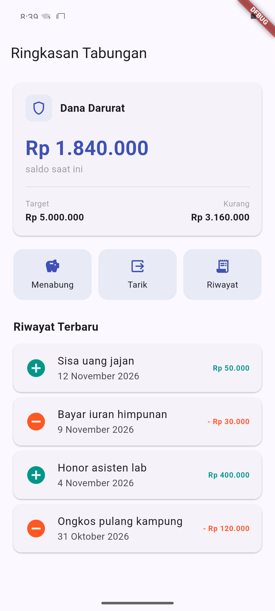
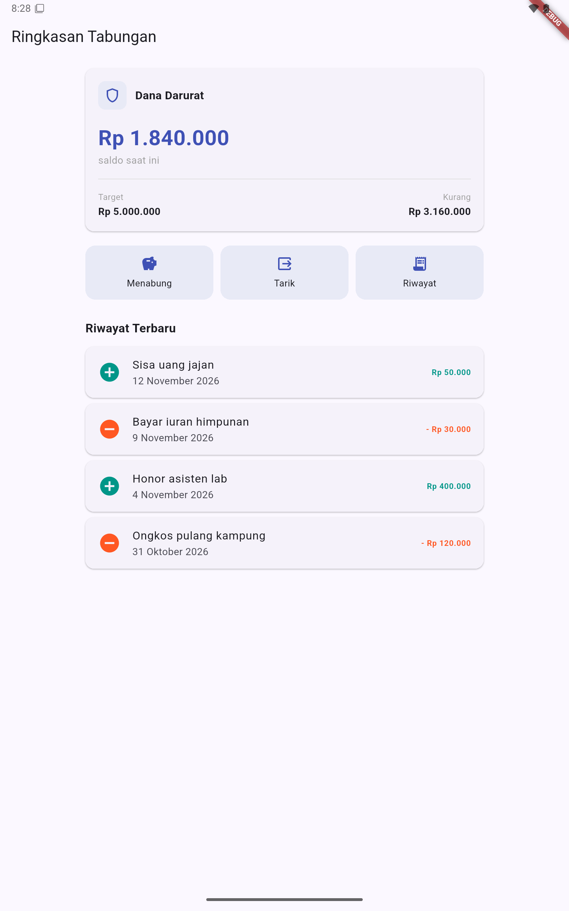

# TabungKu Layout

Tampilan layar **Ringkasan Tabungan** untuk aplikasi TabungKu, dibuat dengan widget dasar Flutter (Pertemuan 1 dan 2) tanpa paket tambahan.

## Data Mahasiswa

| **Keterangan** | **Informasi** |
|---|---|
| **Nama** | Luqman Syahreno |
| **NIM** | 20240801016 |
| **Mata kuliah** | TI505 – Pemrograman Mobile |
| **Tugas** | Minggu 3 – Menyusun Layout dengan Widget Dasar Flutter |
| **Nama Proyek** | TabungKu Layout |

## Ringkasan

Aplikasi ini hanya punya satu halaman, `RingkasanPage`. Halaman ini menampilkan tabungan "Dana Darurat": saldo saat ini, target, sisa kekurangan menuju target, tiga menu kategori, dan riwayat transaksi terbaru. Semua data ditulis langsung di `lib/main.dart` (*hard-coded*) karena tugas ini menilai tata letak, bukan pengolahan data.

## Tampilan

| Ponsel – emulator Pixel 7 (411×914) | Tablet – emulator Pixel Tablet (800×1280) |
|:---:|:---:|
|  |  |

Tangkapan layar diambil dari emulator Android dalam posisi potret. Kedua ukuran layar bebas overflow. Di tablet, lebar isi dibatasi 600 px dan diletakkan di tengah. Pada layar yang lebih pendek, halaman bisa di-scroll.

## Isi Halaman

- **AppBar** dengan judul "Ringkasan Tabungan".
- **Kartu saldo** (`Card`): ikon dan nama tabungan, saldo saat ini, garis pemisah, lalu target (kiri) dan kekurangan (kanan).
- **Menu kategori**: tiga kotak berikon dalam satu baris, yaitu Menabung, Tarik, dan Riwayat.
- **Riwayat Terbaru**: 4 transaksi berisi keterangan, tanggal, dan nominal. Uang masuk ditandai ikon plus berwarna hijau toska, uang keluar ikon minus berwarna oranye.

## Struktur Layout

```text
MaterialApp
└── RingkasanPage
    └── Scaffold
        ├── AppBar ── Text
        └── body: SingleChildScrollView
            └── Center
                └── Container (maxWidth 600)
                    └── Padding
                        └── Column
                            ├── KartuSaldo
                            │   └── Card
                            │       └── Padding
                            │           └── Column
                            │               ├── Row ── Container(Icon), Expanded(Text)
                            │               ├── Text (saldo) + Text ("saldo saat ini")
                            │               ├── Container (garis pemisah)
                            │               └── Row ── Expanded(InfoKecil Target), Expanded(InfoKecil Kurang)
                            ├── MenuKategori
                            │   └── Row ── 3 x Expanded
                            │               └── TombolKategori: Container ── Column ── Icon, Text
                            ├── Text ("Riwayat Terbaru")
                            └── 4 x BarisRiwayat
                                └── Card
                                    └── ListTile ── leading Icon, title, subtitle, trailing Text
```

## Peran Tiap Widget

| Widget | Fungsi di halaman ini |
|---|---|
| `Scaffold`, `AppBar` | Kerangka halaman dan judul di bagian atas. |
| `Card` | Wadah kartu saldo dan setiap baris riwayat. |
| `Padding` | Jarak isi halaman dari tepi layar dan jarak isi kartu dari tepi kartu. |
| `Container` | Kotak ikon dan tombol kategori (warna latar + sudut membulat), garis pemisah, dan pembatas lebar maksimal. |
| `Column` | Menyusun elemen dari atas ke bawah. |
| `Row` | Menyusun elemen berdampingan: ikon + nama, Target + Kurang, tiga kategori. |
| `Expanded` | Membagi lebar `Row` secara rata dan mencegah teks panjang keluar layar. |
| `SizedBox` | Jarak tetap antarelemen. |
| `ListTile` | Susunan standar satu baris riwayat: ikon, judul, tanggal, nominal. |
| `Text`, `Icon` | Menampilkan teks dan ikon. |
| `SingleChildScrollView` | Membuat halaman bisa di-scroll saat tinggi layar tidak cukup. |
| `Center` | Meletakkan isi di tengah pada layar lebar. |

Posisi dan jarak diatur dengan properti `padding`, `margin`, `contentPadding`, `mainAxisAlignment`, dan `crossAxisAlignment`.

## Strategi Agar Tidak Overflow

1. **`SingleChildScrollView` di `body`**: kalau layar pendek, halaman di-scroll, bukan terpotong.
2. **`Expanded` di dalam `Row`**: nama tabungan, Target/Kurang, dan tombol kategori hanya memakai lebar yang tersedia.
3. **`ListTile` untuk riwayat**: keterangan yang panjang otomatis turun baris tanpa menabrak nominal.
4. **Lebar maksimal 600 px**: di tablet tampilan tetap proporsional dan tidak melebar penuh.

## Cara Menjalankan

Prasyarat: Flutter SDK sudah terpasang dan `flutter doctor` tidak menunjukkan error.

```bash
git clone https://github.com/LuqmanSyah/pemrograman-mobile.git
cd pemrograman-mobile/tugas/tabungku_layout
flutter pub get
flutter run
```

Untuk melihat tampilan tablet, buat emulator tablet di Device Manager Android Studio (misalnya Pixel Tablet), jalankan dengan `flutter emulators --launch <nama_emulator>`, lalu `flutter run`.

## Struktur Proyek

```text
tabungku_layout/
├── lib/
│   └── main.dart                 # seluruh kode halaman
├── docs/
│   ├── screenshot-ponsel.png     # tangkapan layar ponsel
│   └── screenshot-tablet.png     # tangkapan layar tablet
├── pubspec.yaml
└── README.md
```
